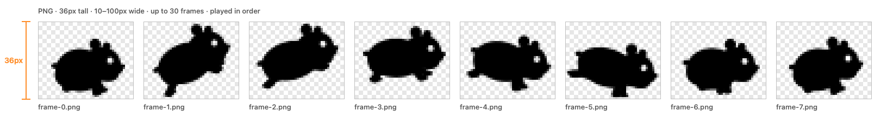

# 커스텀 러너 형식

[English](custom-runner.md) · **한국어**

커스텀 러너는 RunHam이 메뉴바에서 차례로 재생하는 PNG 프레임 묶음입니다.

## 프레임

| | 규칙 |
|---|---|
| 파일 형식 | PNG |
| 높이 | **36px** (메뉴바 18pt를 2배로 그림) |
| 너비 | 10~100px. 프레임마다 너비가 달라도 되고, 가장 넓은 프레임이 러너 너비가 됩니다. |
| 장수 | 1~30장 |
| 순서 | 재생 순서. 폴더를 넣으면 파일 이름 순서로 읽고, 숫자는 크기 순서입니다(`frame-2`가 `frame-10`보다 앞). 편집기에서 순서를 바꿀 수 있습니다. |
| 바탕 | 투명 |

## 흑백과 컬러

- **흑백**: 프레임의 모양(알파)만 쓰고 메뉴바 글자색으로 칠합니다.
  투명 바탕에 한 가지 색으로 그리면 되고, 다크 모드에서는 자동으로 하얗게 바뀝니다. 추천하는 방식입니다.
- **컬러**: 프레임을 그대로 보여 줍니다. 밝은 메뉴바와 어두운 메뉴바 모두에서 잘 보이는지 확인하세요.

## 속도

속도 1(한가한 Mac)에서 **초당 2프레임**을 재생합니다. 6프레임 러너는 한 바퀴에 3초가 걸립니다.
CPU가 바쁠수록 빨라지고(최대 20배), *부하가 높을 때 감속*을 켜면 반대로 느려집니다.

## 잘 보이는 러너 만들기

- 높이 36px를 꽉 채우세요. 작은 그림은 메뉴바에서 잘 안 보입니다.
- 위와 양옆에 1~2px 여백을 두어 가장자리에 닿지 않게 하세요.
- 움직임을 크게 하세요. 18pt에서는 1~2px 차이가 거의 보이지 않습니다.
- 첫 프레임과 마지막 프레임을 비슷하게 해서 반복이 자연스럽게 이어지게 하세요.
- 흑백 실루엣에 하얀 눈(투명 구멍) 하나만 넣어도 훨씬 살아 보입니다.

## RunHam에 넣기

1. **설정 › 러너 › 커스텀 러너 추가…**
2. PNG 파일이나 폴더를 프레임 격자에 끌어 놓거나 **+**를 누릅니다.
3. 이름을 정하고 흑백·컬러를 고른 뒤, 순서와 미리보기를 확인하고 **추가**를 누릅니다.

프레임은 `~/Library/Application Support/RunHam/Runners/`에 복사되므로 원래 파일은 옮기거나 지워도 됩니다.

## 예제

기본 러너가 모두 이 형식으로 [`Runners/`](../Runners/)에 들어 있습니다. 폴더 하나를 편집기에 끌어 놓아 보세요.
