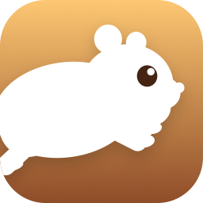
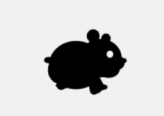
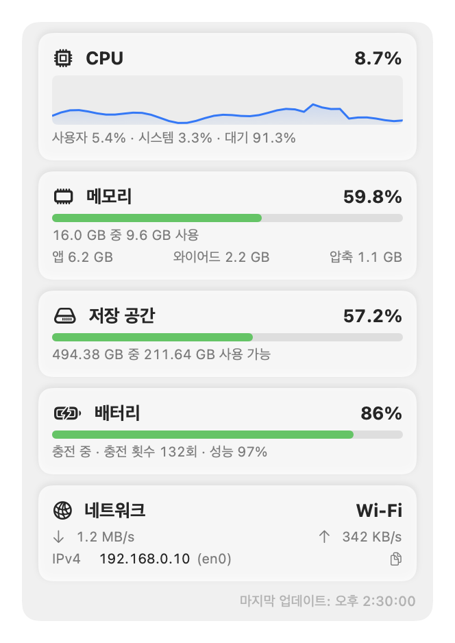
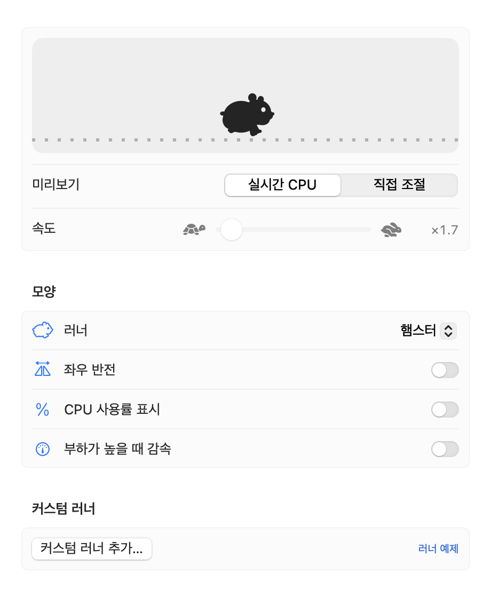
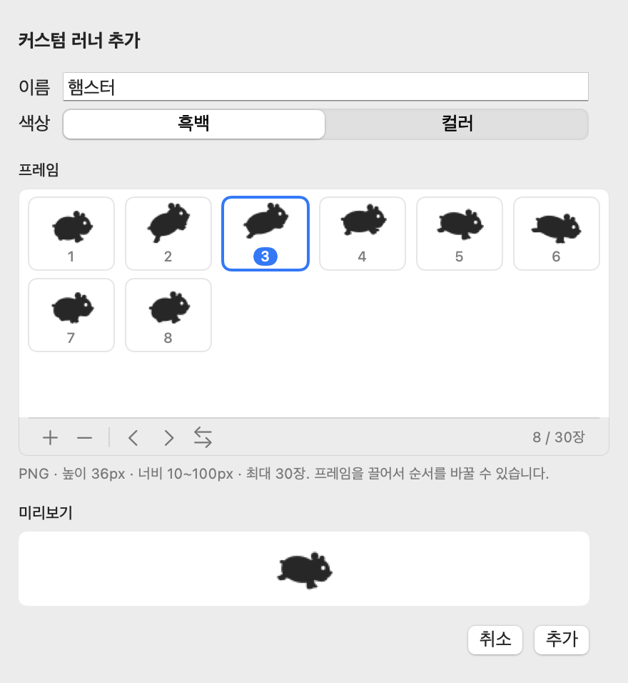

<p align="center">
  
</p>

<h1 align="center">RunHam</h1>

<p align="center">
  CPU가 바빠질수록 더 빨리 깡총깡총 뛰는, Mac 메뉴바 속 햄스터.
</p>

<p align="center">
  <a href="https://github.com/yuchem2/RunHam/releases"></a>
  
  
  <a href="LICENSE"></a>
  
</p>

<p align="center">
  <picture>
    <source media="(prefers-color-scheme: dark)" srcset="Assets/readme/hero-dark.gif">
    
  </picture>
</p>

<p align="center"><a href="README.md">English</a> · <b>한국어</b></p>

---

## 왜 RunHam인가요

- 🐹 **직접 그린 러너 9종.** 햄스터, 고양이, 병아리, 펭귄, 고래, 상어를 모두 같은 스타일로 그렸습니다. 부드러운 실루엣에 하얀 눈 하나라서 메뉴바 크기에서도, 라이트·다크 모드에서도 또렷하게 보입니다.
- 🪶 **Mac에 가볍게.** 외부 라이브러리 없이 Swift로만 만들었습니다. 직접 재 보니 CPU는 RunCat Neo와 비슷하게 쓰면서 메모리는 적고 앱도 작았습니다. [측정 결과 보기](#리소스-사용량)
- 🎨 **앱에서 바로 나만의 러너.** PNG 프레임을 넣고, 끌어서 순서를 정하고, 미리보기로 확인한 뒤 추가합니다. [형식 안내](Formats/custom-runner.ko.md)
- 🧩 **내 데이터를 대시보드에.** 작은 JSON 파일을 쓰는 스크립트라면 무엇이든 실시간 카드가 됩니다. [형식 안내](Formats/custom-metrics.ko.md)

## 기능

- **러너**: CPU가 바쁠수록 빨라집니다. 반대가 좋다면 *부하가 높을 때 감속*을 켜세요.
- **대시보드**: CPU 기록, 메모리, 저장 공간, 배터리, 네트워크(종류·속도·로컬 IP)를 클릭 한 번에 봅니다.
- **메트릭스 바**: 자주 보는 수치를 러너 옆에 항상 띄워 둡니다.
- **4개 언어**: English, 한국어, 日本語, 简体中文을 재시작 없이 바꿉니다.

## 스크린샷

<table>
  <tr>
    <th>대시보드</th>
    <th>설정</th>
  </tr>
  <tr>
    <td valign="top">
      <picture>
        <source media="(prefers-color-scheme: dark)" srcset="Assets/readme/dashboard-ko-dark.png">
        
      </picture>
    </td>
    <td valign="top">
      <picture>
        <source media="(prefers-color-scheme: dark)" srcset="Assets/readme/settings-runner-ko-dark.png">
        
      </picture>
    </td>
  </tr>
</table>

## 러너

<table>
  <tr>
    <td align="center" width="33%"><picture><source media="(prefers-color-scheme: dark)" srcset="Runners/hamster/preview-dark.gif"></picture><br><b>햄스터</b><br><sub>웅크렸다가 박차고 올라 쭉 늘어나며 착지합니다. 기본 러너.</sub></td>
    <td align="center" width="33%"><picture><source media="(prefers-color-scheme: dark)" srcset="Runners/hamster-ball/preview-dark.gif"></picture><br><b>햄스터 공</b><br><sub>굴러가는 운동볼 안에서 종종 달립니다.</sub></td>
    <td align="center" width="33%"><picture><source media="(prefers-color-scheme: dark)" srcset="Runners/hamster-roll/preview-dark.gif"></picture><br><b>데굴데굴 햄스터</b><br><sub>몸을 동그랗게 말고 앞으로 데굴데굴 구릅니다.</sub></td>
  </tr>
  <tr>
    <td align="center" width="33%"><picture><source media="(prefers-color-scheme: dark)" srcset="Runners/hamster-snack/preview-dark.gif"></picture><br><b>해바라기씨 먹는 햄스터</b><br><sub>씨를 오물오물 먹으며 부스러기를 흘립니다.</sub></td>
    <td align="center" width="33%"><picture><source media="(prefers-color-scheme: dark)" srcset="Runners/cat/preview-dark.gif"></picture><br><b>고양이</b><br><sub>긴 꼬리를 휘날리며 갤럽합니다.</sub></td>
    <td align="center" width="33%"><picture><source media="(prefers-color-scheme: dark)" srcset="Runners/chick/preview-dark.gif"></picture><br><b>병아리</b><br><sub>동글동글한 병아리가 통통 뛰어갑니다.</sub></td>
  </tr>
  <tr>
    <td align="center" width="33%"><picture><source media="(prefers-color-scheme: dark)" srcset="Runners/penguin/preview-dark.gif"></picture><br><b>펭귄</b><br><sub>날개를 파닥이며 뒤뚱뒤뚱 걷습니다.</sub></td>
    <td align="center" width="33%"><picture><source media="(prefers-color-scheme: dark)" srcset="Runners/whale/preview-dark.gif"></picture><br><b>고래</b><br><sub>인형 같은 고래가 물결을 타고, 꼬리가 한 박자 늦게 따라옵니다.</sub></td>
    <td align="center" width="33%"><picture><source media="(prefers-color-scheme: dark)" srcset="Runners/shark/preview-dark.gif"></picture><br><b>상어</b><br><sub>백상아리가 입을 덥석거리며 물결을 타고 나아갑니다.</sub></td>
  </tr>
</table>

기본 러너는 모두 [`Runners/`](Runners/) 폴더에 PNG 프레임으로도 들어 있습니다.

## 설치

아직 빌드된 배포판은 없습니다. 소스에서 빌드하세요.

```bash
git clone https://github.com/yuchem2/RunHam.git
cd RunHam
./scripts/bundle.sh          # build/RunHam.app 생성
open build/RunHam.app
```

macOS 14 이상과 Swift 6가 들어 있는 Xcode(또는 Command Line Tools)가 필요합니다.
`build/RunHam.app`을 `/Applications`로 옮기고 설정에서 **로그인 시 실행**을 켜 두면 계속 실행됩니다.

## 사용법

- **대시보드**: 메뉴바의 러너를 누릅니다. 맨 위 ☰ 버튼에서 설정, 활성 상태 보기, RunHam에 관하여, 오픈소스 라이선스, 문제 보고, 종료를 엽니다.
- **설정 › 러너**: 러너를 고르고, 좌우 반전, 옆에 CPU 사용률 표시, 부하가 높을 때 감속을 설정합니다.
- **설정 › 메트릭**: 대시보드 카드와 메트릭스 바에 보일 항목을 고릅니다.

### 커스텀 러너

<picture>
  <source media="(prefers-color-scheme: dark)" srcset="Assets/readme/custom-runner-ko-dark.png">
  
</picture>

1. **설정 › 러너 › 커스텀 러너 추가…**를 엽니다.
2. **+**를 누르거나 PNG 파일·폴더를 프레임 격자에 끌어 놓습니다.
3. 프레임을 끌거나 ‹ ›로 순서를 정하고, 미리보기를 확인한 뒤 **추가**를 누릅니다.

프레임은 PNG, 높이 36px, 너비 10~100px, 최대 30장입니다.
**흑백**은 메뉴바 글자색을 따르고, **컬러**는 원래 색을 그대로 씁니다.
자세한 규칙과 팁은 [커스텀 러너 형식](Formats/custom-runner.ko.md)을 보세요.

<br clear="right">

### 커스텀 메트릭

**설정 › 메트릭 › 사용자 지정 메트릭**에서 JSON 파일을 등록하면 대시보드 카드로 보이고, 파일이 바뀔 때마다 갱신됩니다.

```json
{
  "title": "Build Server",
  "symbol": "hammer.fill",
  "metrics": [
    { "title": "Queue", "formattedValue": "3 of 4 jobs", "normalizedValue": 0.75 }
  ],
  "lastUpdatedDate": "2026-10-23T00:00:00Z"
}
```

[커스텀 메트릭 형식](Formats/custom-metrics.ko.md)과 [JSON 스키마](Formats/custom-metrics.schema.json)를 보세요.
[`scripts/custom-metrics-example.sh`](scripts/custom-metrics-example.sh)가 5초마다 시스템 부하를 기록하는 예제입니다.

## 리소스 사용량

같은 Mac(Apple M5, macOS 26.7)에서 두 앱을 함께 켜 두고, 메뉴를 닫고 메트릭스 바를 끈 한가한 상태로
4초마다 2분 동안 쟀습니다(RunHam: 햄스터, RunCat Neo: 고양이).

| | RunHam 0.1.0 | RunCat Neo 1.0 |
|---|---:|---:|
| CPU (평균) | **0.4%** | 0.5% |
| CPU (최대) | **0.9%** | 2.1% |
| 메모리 | **약 40MB** | 약 66MB |
| 앱 크기 | **2.5MB** | 4.6MB |

메모리는 앱을 한동안 실행한 뒤 활성 상태 보기의 *메모리* 열 값입니다.
러너, 업데이트 간격, 대시보드 카드 설정에 따라 달라질 수 있습니다.

## 개발

```bash
./scripts/test.sh               # 단위 테스트
./scripts/export-showcase.sh    # Runners/ 와 README 이미지를 다시 만듦
./scripts/make-icon.sh          # Assets/AppIcon.icns 를 다시 만듦
```

- 러너와 앱 아이콘은 Core Graphics 코드로 그립니다(`Sources/RunHam/Runner/`, `AppIconRenderer`). 이미지 에셋은 넣지 않습니다.
- 기본 러너를 추가하는 방법은 [`Runners/README.ko.md`](Runners/README.ko.md)를 보세요.
- 새 언어는 영어와 같은 키로 `Sources/RunHam/Resources/<code>.lproj/Localizable.strings`를 추가합니다. 빠진 키가 있으면 테스트가 알려 줍니다.
- 외부 라이브러리는 쓰지 않습니다. 추가하면 `LicensesView.entries`에 적고 `Sources/RunHam/Resources/Licenses/`에 라이선스를 넣습니다.

## 문제 보고

☰ 메뉴에서 **문제 보고**를 누르면 환경 정보가 채워진 새 이슈 화면이 열립니다. [GitHub Issues](https://github.com/yuchem2/RunHam/issues)에서 직접 남겨도 됩니다.

## 감사의 말

RunHam은 [RunCat Neo](https://github.com/runcat-dev/RunCatNeo)(Copyright 2026 Kyome22 / Takuto Nakamura, Apache License 2.0)에서
영감을 받아 새로 만들었습니다. RunCat Neo의 코드와 이미지는 포함하지 않습니다.

## 라이선스

RunHam은 [Apache License 2.0](LICENSE)으로 배포됩니다.
