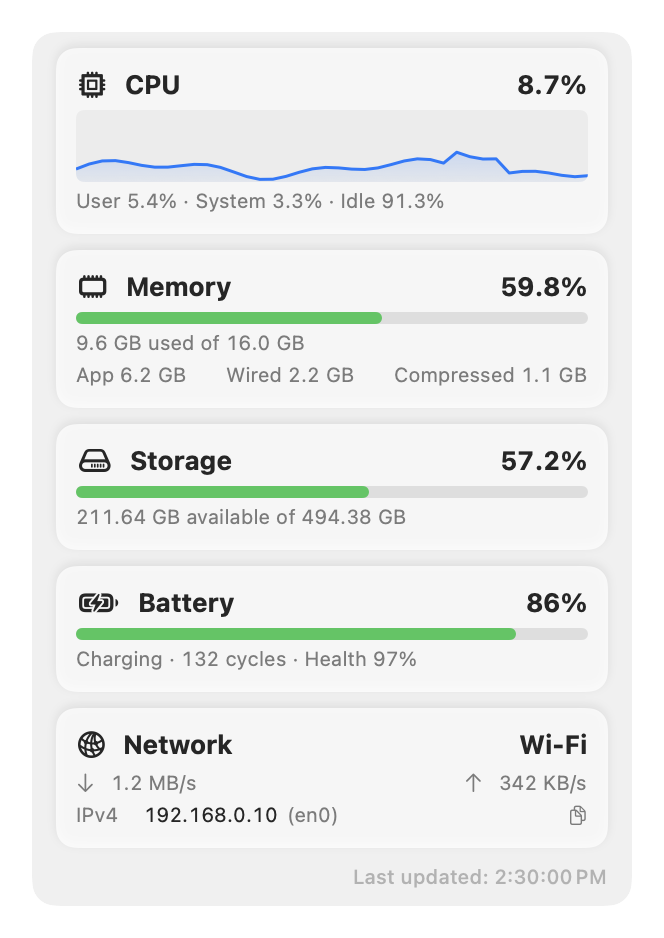
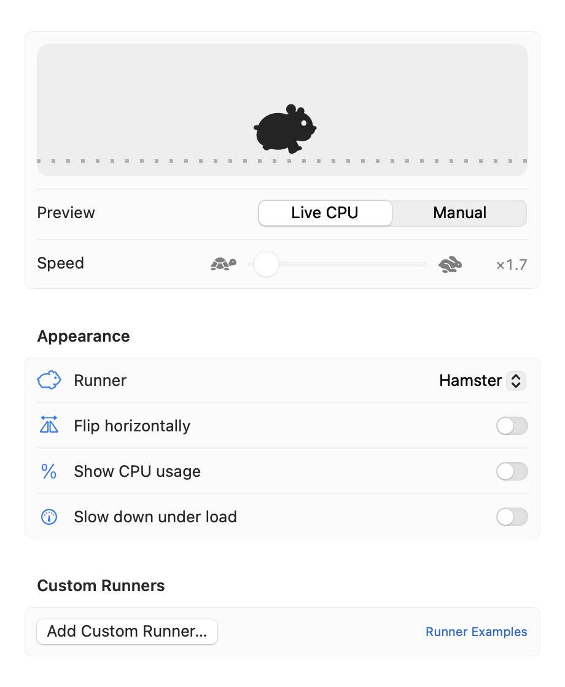
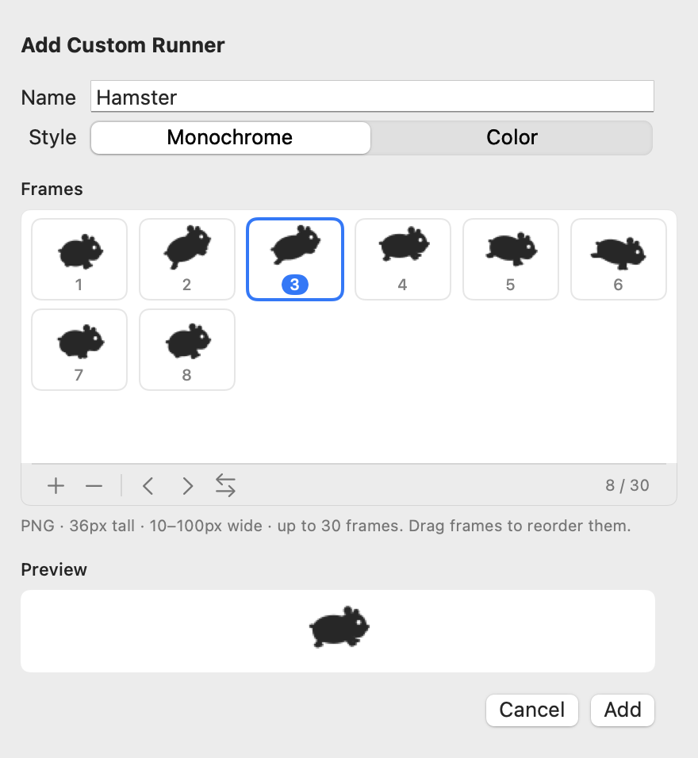

<p align="center">
  
</p>

<h1 align="center">RunHam</h1>

<p align="center">
  A hamster in your Mac's menu bar that hops faster as your CPU gets busier.
</p>

<p align="center">
  <a href="https://github.com/yuchem2/RunHam/releases"></a>
  
  
  <a href="LICENSE"></a>
  
</p>

<p align="center">
  <picture>
    <source media="(prefers-color-scheme: dark)" srcset="Assets/readme/hero-dark.gif">
    
  </picture>
</p>

<p align="center"><b>English</b> · <a href="README.ko.md">한국어</a></p>

---

## Why RunHam

- 🐹 **Nine hand-drawn runners.** Hamsters, a cat, a chick, a penguin, a whale and a shark, all drawn in one consistent style: a soft silhouette with a single white eye that reads clearly at menu bar size, in light and dark mode.
- 🪶 **Light on your Mac.** Native Swift with no third-party libraries. In our measurements it used about the same CPU as RunCat Neo, with less memory and a smaller app. [See the numbers](#resource-usage).
- 🎨 **Make your own runner in the app.** Drop in PNG frames, drag them into order, and preview the animation before adding. [Format guide](Formats/custom-runner.md)
- 🧩 **Your own data on the dashboard.** Any script that writes a small JSON file can add a live card. [Format guide](Formats/custom-metrics.md)

## Features

- **Runner**: the busier the CPU, the faster it moves. Prefer the opposite? Turn on *Slow down under load*.
- **Dashboard**: CPU history, memory, storage, battery and network (type, speed and local IP) one click away.
- **Metrics Bar**: keep the numbers you care about next to the runner at all times.
- **Four languages**: English, 한국어, 日本語 and 简体中文, switchable without restarting.

## Screenshots

<table>
  <tr>
    <th>Dashboard</th>
    <th>Settings</th>
  </tr>
  <tr>
    <td valign="top">
      <picture>
        <source media="(prefers-color-scheme: dark)" srcset="Assets/readme/dashboard-en-dark.png">
        
      </picture>
    </td>
    <td valign="top">
      <picture>
        <source media="(prefers-color-scheme: dark)" srcset="Assets/readme/settings-runner-en-dark.png">
        
      </picture>
    </td>
  </tr>
</table>

## Runners

<table>
  <tr>
    <td align="center" width="33%"><picture><source media="(prefers-color-scheme: dark)" srcset="Runners/hamster/preview-dark.gif"></picture><br><b>Hamster</b><br><sub>Crouches, kicks off and lands with a stretch. The default runner.</sub></td>
    <td align="center" width="33%"><picture><source media="(prefers-color-scheme: dark)" srcset="Runners/hamster-ball/preview-dark.gif"></picture><br><b>Hamster Ball</b><br><sub>Scurries inside a rolling exercise ball.</sub></td>
    <td align="center" width="33%"><picture><source media="(prefers-color-scheme: dark)" srcset="Runners/hamster-roll/preview-dark.gif"></picture><br><b>Rolling Hamster</b><br><sub>Curls up into a ball and rolls forward.</sub></td>
  </tr>
  <tr>
    <td align="center" width="33%"><picture><source media="(prefers-color-scheme: dark)" srcset="Runners/hamster-snack/preview-dark.gif"></picture><br><b>Snacking Hamster</b><br><sub>Munches a sunflower seed, dropping crumbs.</sub></td>
    <td align="center" width="33%"><picture><source media="(prefers-color-scheme: dark)" srcset="Runners/cat/preview-dark.gif"></picture><br><b>Cat</b><br><sub>Gallops with a long, streaming tail.</sub></td>
    <td align="center" width="33%"><picture><source media="(prefers-color-scheme: dark)" srcset="Runners/chick/preview-dark.gif"></picture><br><b>Chick</b><br><sub>A round little chick hopping along.</sub></td>
  </tr>
  <tr>
    <td align="center" width="33%"><picture><source media="(prefers-color-scheme: dark)" srcset="Runners/penguin/preview-dark.gif"></picture><br><b>Penguin</b><br><sub>Waddles side to side, flapping its flippers.</sub></td>
    <td align="center" width="33%"><picture><source media="(prefers-color-scheme: dark)" srcset="Runners/whale/preview-dark.gif"></picture><br><b>Whale</b><br><sub>A plush whale riding the waves, tail a beat behind.</sub></td>
    <td align="center" width="33%"><picture><source media="(prefers-color-scheme: dark)" srcset="Runners/shark/preview-dark.gif"></picture><br><b>Shark</b><br><sub>A great white surging through the water, jaws snapping.</sub></td>
  </tr>
</table>

Every built-in runner is also available as plain PNG frames in [`Runners/`](Runners/).

## Installation

**Requires macOS 14 or later on Apple silicon (M1 or later).**

1. Download the latest `RunHam-x.y.z.zip` from [Releases](https://github.com/yuchem2/RunHam/releases/latest) and unzip it.
2. Move `RunHam.app` to the Applications folder.
3. RunHam is not notarized by Apple yet, so macOS blocks the first launch. Open it once in one of these ways:
   - Right-click (or Control-click) `RunHam.app`, choose **Open**, then **Open** again.
   - Or try to open it, then go to **System Settings › Privacy & Security** and click **Open Anyway**.
   - Or run `xattr -dr com.apple.quarantine /Applications/RunHam.app` in Terminal.

Turn on **Launch at login** in Settings to keep it running.

### Build from source

```bash
git clone https://github.com/yuchem2/RunHam.git
cd RunHam
./scripts/bundle.sh          # creates build/RunHam.app
open build/RunHam.app
```

Requires Xcode (or the Command Line Tools) with Swift 6.

## Usage

- **Dashboard**: click the runner in the menu bar. The ☰ button at the top opens Settings, Activity Monitor, About, Open Source Licenses, Report a Problem and Quit.
- **Settings › Runner**: choose a runner, flip it, show the CPU percentage next to it, or slow it down under load.
- **Settings › Metrics**: choose dashboard cards and what the Metrics Bar shows.

### Custom runners

<picture>
  <source media="(prefers-color-scheme: dark)" srcset="Assets/readme/custom-runner-en-dark.png">
  
</picture>

1. Open **Settings › Runner › Add Custom Runner…**
2. Click **+** or drop PNG files or a folder onto the frame grid.
3. Drag frames (or use ‹ ›) to set the order, check the preview, and click **Add**.

Frames are PNG, 36 px tall, 10–100 px wide, up to 30.
**Monochrome** runners follow the menu bar text color; **Color** keeps the original colors.
See the [custom runner format](Formats/custom-runner.md) for details and tips.

<br clear="right">

### Custom metrics

Register a JSON file in **Settings › Metrics › Custom Metrics** and it shows up as a dashboard card that refreshes whenever the file changes.

```json
{
  "title": "Build Server",
  "symbol": "hammer.fill",
  "metrics": [
    { "title": "Queue", "formattedValue": "3 of 4 jobs", "normalizedValue": 0.75 }
  ],
  "lastUpdatedDate": "2026-10-23T00:00:00Z"
}
```

See the [custom metrics format](Formats/custom-metrics.md) and the [JSON Schema](Formats/custom-metrics.schema.json).
[`scripts/custom-metrics-example.sh`](scripts/custom-metrics-example.sh) writes your system load every 5 seconds as a working example.

## Resource usage

Measured side by side on the same Mac (Apple M5, macOS 26.7), both apps idle with the menu closed and the Metrics Bar off,
sampled every 4 seconds for 2 minutes (RunHam: Hamster, RunCat Neo: Cat).

| | RunHam 0.1.0 | RunCat Neo 1.0 |
|---|---:|---:|
| CPU (average) | **0.4%** | 0.5% |
| CPU (peak) | **0.9%** | 2.1% |
| Memory | **about 40 MB** | about 66 MB |
| App size | **2.5 MB** | 4.6 MB |

Memory is Activity Monitor's *Memory* column after the app had been running for a while.
Your numbers will vary with the runner, update interval and dashboard cards.

## Development

```bash
./scripts/test.sh               # unit tests
./scripts/export-showcase.sh    # regenerates Runners/ and the README images
./scripts/make-icon.sh          # regenerates Assets/AppIcon.icns
./scripts/release.sh            # builds build/RunHam-<version>.zip (--upload creates the GitHub release)
```

- Runners and the app icon are drawn in code with Core Graphics (`Sources/RunHam/Runner/`, `AppIconRenderer`). No image assets are bundled.
- To add a built-in runner, see [`Runners/README.md`](Runners/README.md).
- To add a language, add `Sources/RunHam/Resources/<code>.lproj/Localizable.strings` with the same keys as English. The tests check that no key is missing.
- RunHam uses no third-party libraries. If you add one, list it in `LicensesView.entries` and put its license in `Sources/RunHam/Resources/Licenses/`.

## Report a problem

Choose **Report a Problem** from the ☰ menu to open a new issue with your environment details already filled in, or open one on [GitHub Issues](https://github.com/yuchem2/RunHam/issues).

## Acknowledgements

RunHam was built from scratch, inspired by [RunCat Neo](https://github.com/runcat-dev/RunCatNeo)
(Copyright 2026 Kyome22 / Takuto Nakamura, Apache License 2.0). It does not include RunCat Neo's code or images.

## License

RunHam is released under the [Apache License 2.0](LICENSE).
