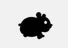
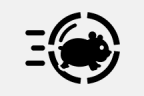
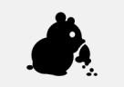
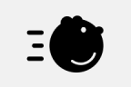
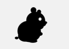
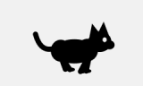
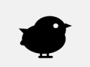
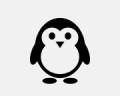
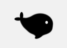
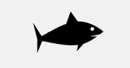

# Runners

**English** · [한국어](README.ko.md)

PNG frames of RunHam's built-in runners. They are generated from the drawing code, so do not edit them by hand.

| Preview | Folder | Runner | Frames | Size (pt) |
|:---:|---|---|---:|---|
|  | [`hamster/`](hamster/) | Hamster (default) | 8 | 22 × 18 |
|  | [`hamster-ball/`](hamster-ball/) | Hamster Ball | 8 | 24 × 18 |
|  | [`hamster-snack/`](hamster-snack/) | Snacking Hamster | 6 | 22 × 18 |
|  | [`hamster-roll/`](hamster-roll/) | Rolling Hamster | 8 | 24 × 18 |
|  | [`hamster-cheeks/`](hamster-cheeks/) | Cheeky Hamster | 8 | 22 × 18 |
|  | [`cat/`](cat/) | Cat | 8 | 28 × 18 |
|  | [`chick/`](chick/) | Chick | 6 | 20 × 18 |
|  | [`penguin/`](penguin/) | Penguin | 8 | 18 × 18 |
|  | [`whale/`](whale/) | Whale | 8 | 30 × 18 |
|  | [`shark/`](shark/) | Shark | 8 | 34 × 18 |
| | [`sleeping-hamster.png`](sleeping-hamster.png) | Shown in an empty Metrics Bar | 1 | 28 × 18 |

Each folder contains:

- `<id>-frame-<n>.png`: frames in playback order, 36 px tall (menu bar height at @2x). Black silhouettes on a transparent background.
- `preview-light.gif` / `preview-dark.gif`: previews on light and dark menu bar colors.

## Using the frames elsewhere

The frames follow the [custom runner format](../Formats/custom-runner.md) (PNG, 36 px tall, 10–100 px wide, up to 30 frames).
In RunHam, choose **Settings › Runner › Add Custom Runner…** and drop a folder in.

## Adding a built-in runner

Runners are drawn in code with Core Graphics, so they stay sharp at any size.

1. Add `Sources/RunHam/Runner/<Name>Sprite.swift` with a `makeRunner()` that returns a `Runner`
   (`id`, `nameKey`, `frames` at 2× scale, `previewFrames` at 6×, and `baseFrameRate`).
   `DrawnRunner.make` handles the canvas and scales; hamsters can reuse `HamsterSilhouette`,
   and swimming animals can reuse `SwimmerBody`.
2. Add it to `Runner.builtIns` in `Sources/RunHam/Runner/Runner.swift`.
3. Add `"runner.<key>"` to every `Localizable.strings` (en, ko, ja, zh-Hans).
4. Run `./scripts/test.sh`.
5. Run `./scripts/export-showcase.sh` to regenerate this folder and the README images, then add the new runner to the README tables.

Keep the silhouette readable at 18 pt: a clear outline, one white eye, and motion large enough to notice in the menu bar.
